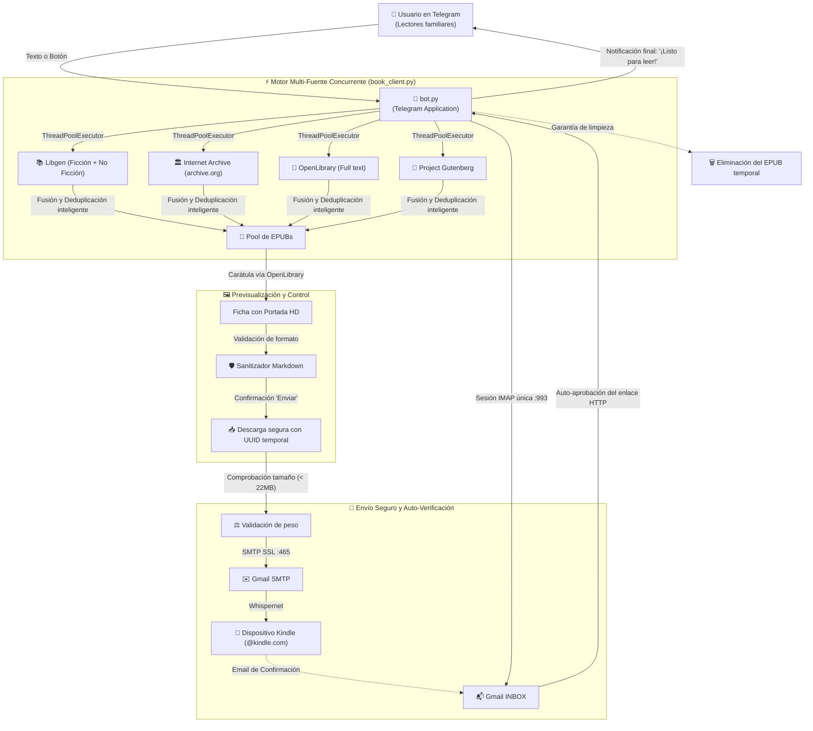

# 📚⚡ GaBookAutoDownloader (Family UX 2.0)

Bot autónomo de Telegram para la búsqueda multi-fuente, previsualización interactiva con portadas, descarga y entrega de libros en formato `.epub` directamente a dispositivos Amazon Kindle familiares, con verificación automática de correo en Gmail y blindaje de estabilidad 24/7.

---

## 🌟 Características Destacadas

* **Motor Multi-Fuente Paralelo**: Consulta simultáneamente **Libgen** (ficción contemporánea, bestsellers y no-ficción), **Internet Archive** (libros raros y descatalogados), **OpenLibrary** (ediciones de texto completo) y **Project Gutenberg** (clásicos de la literatura).
* **Filtro Inteligente de Idioma**: Prioriza automáticamente resultados en español, con soporte para especificar idiomas en lenguaje natural (`Dune en inglés`, `1984 [es]`).
* **Explorador de 24 Géneros Literarios**: Menú interactivo paginado con temáticas especializadas (Arqueología, Antropología, Arquitectura, Novela Histórica Épica, Bélica, Espionaje, Ucronías, Thriller Tecnológico, Policial, Ensayo, etc.).
* **Ficha de Previsualización con Portadas**: Muestra la portada oficial en alta definición (vía OpenLibrary API), ficha técnica, tamaño y destino antes de confirmar el envío.
* **Perfiles Familiares a 1 Toque**: Selección inmediata de dispositivos (personalizables vía variables de entorno):
  * 👨‍🦳 Kindle de Papá (`familiar1@kindle.com`)
  * 👦 Kindle de Gonzalo (`familiar2@kindle.com`)
  * 👤 Mi Kindle (`tu_kindle@kindle.com`)
* **Verificación Automática de Amazon (IMAP)**: Monitorea la bandeja de entrada de Gmail en segundo plano con una conexión IMAP SSL persistente y segura. Si Amazon envía un correo de confirmación (*"Verifica tu documento de Send to Kindle"*), el bot extrae el enlace, lo decodifica y lo aprueba automáticamente vía HTTP sin intervención del usuario.
* **Zero Comandos (Senior Friendly)**: Diseñado para usuarios no técnicos. Incluye teclado inferior persistente y comprensión de lenguaje cotidiano (`reiniciar`, `temas`, `ayuda`, `kindle`).
* **Pipeline de Alta Resiliencia**: Sanitización de entidades Markdown de Telegram, escritura atómica en base de datos local, expiración de sesiones en memoria (TTL), nombres temporales resistentes a colisiones y control preventivo de tamaño de archivo (< 22 MB).

---

## 🏗️ Arquitectura del Sistema y Pipeline



---

## 📁 Estructura del Proyecto

```text
GaBookAutoDownloader/
├── bot.py                  # Orquestador del Bot de Telegram, UX y gestión de sesiones
├── book_client.py          # Motor de búsqueda multi-fuente paralelo y descargador de EPUBs
├── kindle_mailer.py        # Módulo de envío por correo vía Gmail SMTP SSL con control de tamaño
├── gmail_monitor.py        # Monitor IMAP persistente y auto-aprobador de enlaces de Amazon
├── user_manager.py         # Persistencia atómica de perfiles de Kindle e idioma
├── users.example.json      # Plantilla de ejemplo para la base de datos de usuarios
├── test_features.py        # Suite de pruebas unitarias automatizadas (9 tests)
├── setup_macos_service.sh  # Instalador del bot como servicio nativo de macOS (launchd)
├── Dockerfile              # Empaquetado para despliegue en la nube 24/7 (Render / Railway)
├── .dockerignore           # Exclusiones de seguridad para el contenedor Docker
├── requirements.txt        # Dependencias de Python
├── GUIA_USUARIO.md         # Guía de uso rápido para la familia
├── README.md               # Esta documentación técnica
└── .env                    # Variables de entorno y credenciales (ignorado en git)
```

---

## 🛡️ Robustez y Blindaje del Pipeline

Tras la auditoría técnica, el pipeline incorpora las siguientes salvaguardas para operar 24/7 de forma desatendida:

1. **Prevención de Caídas por Markdown (`escape_md`)**: Todos los títulos, autores y búsquedas dinámicas se escapan automáticamente antes de inyectarse en Telegram Markdown v1, eliminando excepciones `Can't parse entities` por caracteres como `_`, `*`, `[` o `` ` ``.
2. **Conexión IMAP Persistente**: La monitorización de verificación reutiliza una sola conexión segura con `mail.noop()` y timeout de red, evitando bloqueos por límite de conexiones de Google.
3. **Escritura Atómica en Base de Datos**: `user_manager.py` escribe mediante un archivo temporal y reemplazo atómico (`os.replace`), impidiendo la corrupción de `users.json` en caídas o reinicios.
4. **Filtro de Tamaño Máximo de Envío**: Valida que el archivo no supere los 22 MB antes de cargarlo a SMTP, informando amigablemente al usuario en lugar de fallar silenciosamente.
5. **Nombres de Archivo Temporales Aislados**: Genera nombres con sufijo UUID (`libro_a1b2c3.epub`) para prevenir condiciones de carrera en descargas concurrentes.
6. **Gestión de Memoria en RAM**: Expira sesiones de búsqueda inactivas tras 2 horas (TTL) con un límite de 150 sesiones activas para evitar crecimiento indefinido de memoria.
7. **Supresión de Errores Benignos**: Manejo global de excepciones para descartar eventos inofensivos de Telegram como `Message is not modified`.

---

## ⚙️ Configuración (`.env`)

Crea un archivo `.env` en la raíz del proyecto con la siguiente estructura:

```env
# Token del Bot de Telegram (obtenido con @BotFather)
TELEGRAM_BOT_TOKEN="tu_token_aqui"

# Credenciales de Gmail para envíos y lectura de verificación
GMAIL_USER="tu_correo@gmail.com"
GMAIL_APP_PASSWORD="tu_contrasena_de_aplicacion_google"

# Correo predeterminado de Kindle
KINDLE_EMAIL="tu_kindle@kindle.com"

# Perfiles familiares opcionales (para los botones táctiles del bot)
KINDLE_EMAIL_PAPA="familiar1@kindle.com"
KINDLE_EMAIL_GONZALO="familiar2@kindle.com"
KINDLE_EMAIL_GABRIEL="tu_kindle@kindle.com"
```

> [!IMPORTANT]
> Para generar `GMAIL_APP_PASSWORD`:
> 1. Accede a tu cuenta de Google ➔ **Seguridad** ➔ **Verificación en 2 pasos**.
> 2. En la sección inferior, busca **Contraseñas de aplicaciones**.
> 3. Genera una nueva contraseña llamada "Kindle Bot" (clave de 16 letras sin espacios).

---

## 🛠️ Instalación, Pruebas y Ejecución Local

```bash
# 1. Crear y activar el entorno virtual
python3 -m venv venv
source venv/bin/activate

# 2. Instalar dependencias
pip install -r requirements.txt

# 3. Ejecutar suite de pruebas unitarias
python -m unittest test_features.py

# 4. Iniciar el bot
python bot.py
```

---

## 🚀 Opciones de Despliegue 24/7

### Opción A: En tu Mac como Servicio Permanente (launchd)
Para que el bot se ejecute en segundo plano, arranque solo al encender el Mac y se reinicie automáticamente si falla:

```bash
./setup_macos_service.sh
```

* **Ver registros en directo**:
  ```bash
  tail -f bot_stdout.log
  ```
* **Detener el servicio**:
  ```bash
  launchctl unload ~/Library/LaunchAgents/com.gabookautodownloader.plist
  ```

---

### Opción B: En la Nube Gratuita 24/7 (Render / Railway / Koyeb)
El proyecto incluye un `Dockerfile` y `.dockerignore` optimizados:

1. El repositorio se encuentra alojado en GitHub:
   👉 **[gtrujillovdev-cyber/GaBookAutoDownloader](https://github.com/gtrujillovdev-cyber/GaBookAutoDownloader)**
2. Entra en [Render.com](https://render.com) ➔ **New +** ➔ **Background Worker**.
3. Selecciona tu repositorio de GitHub.
4. En **Environment Variables**, añade las variables de tu archivo `.env`:
   * `TELEGRAM_BOT_TOKEN`
   * `GMAIL_USER`
   * `GMAIL_APP_PASSWORD`
   * `KINDLE_EMAIL`
5. Pulsa en **Deploy**. El bot quedará activo las 24 horas del día sin necesidad de tener tu ordenador encendido.

---

## ❓ Solución de Problemas Frecuentes (FAQ)

### 1. El libro se envió pero no aparece en el Kindle
* **Falta el remitente en Amazon**: La cuenta de Amazon de ese Kindle debe tener añadido tu correo de Gmail remitente (`GMAIL_USER`) en su lista de remitentes aprobados ([Preferencias de Amazon](https://www.amazon.es/hz/mycd/myx#/home/settings/payment)).
* **Filtro de biblioteca**: En los Kindles modernos, los libros enviados por correo se catalogan como **"Documentos"** y no como "Libros". Comprueba que el filtro de la biblioteca esté en **"Documentos"** o **"Todos"**.
* **Falta sincronizar**: Desliza hacia abajo en la pantalla del Kindle y toca el icono **"Sincronizar"** con el Wi-Fi activado.

### 2. Amazon pide verificar el documento
* Nuestro monitor de Gmail (`gmail_monitor.py`) revisa tu bandeja de entrada en segundo plano y aprueba el enlace automáticamente por ti. Si por algún motivo expirase o la red fallara, el bot te indicará el enlace para hacer clic manual.
