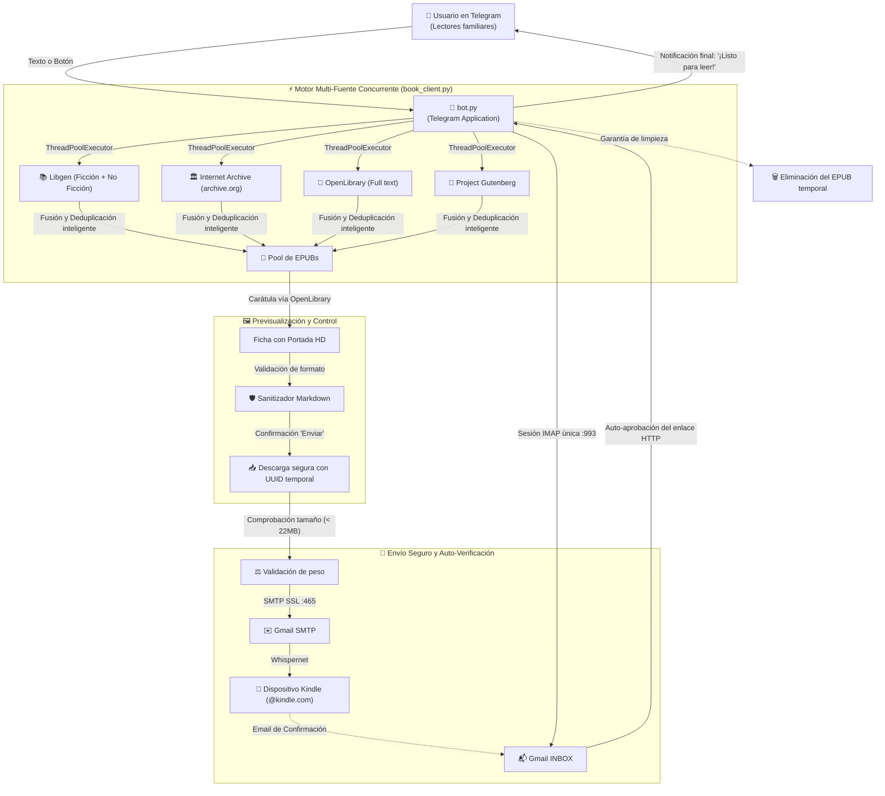

# 📚⚡ GaBookAutoDownloader (Family UX 2.0)

Bot autónomo de Telegram para la búsqueda multi-fuente, previsualización interactiva con portadas, descarga y entrega de libros en formato `.epub` directamente a dispositivos Amazon Kindle familiares, con verificación automática de correo en Gmail y blindaje de estabilidad 24/7.

---

## 📖 Guía Rápida de Inicio: Cómo usar el Bot (Paso a Paso)

Con este bot puedes pedir cualquier libro desde Telegram y tenerlo listo para leer en tu lector Kindle en menos de un minuto, sin cables ni ordenadores.

### 🚀 Paso 1: Configuración Inicial *(Solo se hace 1 vez, 1 minuto)*

Amazon bloquea los envíos a Kindle si el remitente no está en su lista blanca. Para autorizar al bot:

1. **Abre el bot en Telegram y pulsa Iniciar.**
2. **Autoriza el correo del bot en Amazon:**
   * En el chat, escribe `/autorizar` o pulsa el botón **`[ 🛡️ Autorizar en Amazon ]`**.
   * Toca el correo remitente que aparece en pantalla para copiarlo con 1 solo toque.
   * Pulsa el botón **`[ 🔗 Abrir Amazon.es (Ajustes) ]`** (te abre directamente la pestaña **Preferencias** en tu cuenta de Amazon).
   * Desliza la página hasta **abajo del todo** a la sección *"Configuración de documentos personales"*, y en *"Lista de direcciones de correo electrónico autorizadas para el envío de documentos personales"*, pulsa **"Añadir una nueva dirección"**, pega el correo y pulsa Guardar.
3. **Conecta tu Kindle al bot:**
   * Toca **`🎯 Mi Kindle`** en la barra inferior y elige tu perfil familiar.
   * Si eres un usuario nuevo, pulsa **`[ ✏️ Configurar otro Kindle ]`** y escribe tu dirección `@kindle.com` *(la encuentras en tu Kindle en Ajustes ➔ Mi cuenta ➔ Correo Send to Kindle)*.

> ¡Listo! Nunca más tendrás que volver a configurar nada.

---

### 🔍 Paso 2: Cómo pedir cualquier libro

Tienes tres formas muy cómodas de pedir lo que quieras:

* **Opción A (Escribir):** Escribe el título o el autor directamente en el chat, tal como hablarías con una persona:
  * `Dune`
  * `El problema de los 3 cuerpos`
  * `Stephen King`
  * `Carmen Mola`
  * *(Si buscas en otro idioma, añade el idioma al final: `Atomic Habits en inglés`)*.
* **Opción B (Explorar Temas 📚):** Si no sabes qué leer, pulsa el botón **`📚 Explorar por Temas`** en la barra inferior para navegar entre 24 géneros literarios (Novela histórica, Ciencia ficción, Negra, Filosofía, etc.).
* **Opción C (Nota de Voz 🎙️):** Mantén pulsado el micrófono de Telegram y di en voz alta lo que buscas (ej. *"Búscame Los Pilares de la Tierra"*).

---

### 📦 Paso 3: Previsualización y Envío

1. En la lista de resultados, **toca el libro** que más te interese.
2. Se abrirá la **Ficha del Libro** con su portada oficial en alta definición, sinopsis, año, idioma y tamaño.
3. Pulsa el botón **`[ 🚀 Enviar a mi Kindle ]`**.
4. El bot descargará el archivo, verificará el formato y te confirmará el envío en pocos segundos.

---

### 📱 Paso 4: Cómo abrirlo y leerlo en tu Kindle físico

1. Enciende tu lector Kindle y asegúrate de que el **Wi-Fi esté activado**.
2. Desliza el dedo desde la parte superior de la pantalla hacia abajo y pulsa el icono de **Sincronizar** (las dos flechas en círculo).
3. **⚠️ Truco para Kindles modernos (Últimos modelos):**
   * Los libros enviados por correo no se guardan en la pestaña "Libros" (reservada para compras en la tienda de Amazon).
   * Comprueba el filtro superior de tu Biblioteca y asegúrate de tener seleccionado **"Documentos"** o **"Todos"**.

---

## 🌟 Características Destacadas

* **Motor Multi-Fuente Paralelo**: Consulta simultáneamente **Libgen** (ficción contemporánea, bestsellers y no-ficción), **Internet Archive** (libros raros y descatalogados), **OpenLibrary** (ediciones de texto completo) y **Project Gutenberg** (clásicos de la literatura).
* **Filtro Inteligente de Idioma**: Prioriza automáticamente resultados en español, con soporte para especificar idiomas en lenguaje natural (`Dune en inglés`, `1984 [es]`).
* **Explorador de 24 Géneros Literarios**: Menú interactivo paginado con temáticas especializadas (Arqueología, Antropología, Arquitectura, Novela Histórica Épica, Bélica, Espionaje, Ucronías, Thriller Tecnológico, Policial, Ensayo, etc.).
* **Ficha de Previsualización con Portadas**: Muestra la portada oficial en alta definición (vía OpenLibrary API), ficha técnica, tamaño y destino antes de confirmar el envío.
* **Perfiles Familiares a 1 Toque**: Selección inmediata de dispositivos (personalizables vía variables de entorno):
  * 👨‍🦳 Kindle de Papá (`familiar1@kindle.com`)
  * 👦 Kindle de Gonzalo (`familiar2@kindle.com`)
  * 👤 Mi Kindle (`tu_kindle@kindle.com`)
* **Verificación Automática de Amazon (IMAP)**: Monitorea la bandeja de entrada de Gmail en segundo plano con una conexión IMAP SSL persistente y segura. Si Amazon envía un correo de confirmación (*"Verifica tu documento de Send to Kindle"*), el bot extrae el enlace, lo decodifica y lo aprueba automáticamente vía HTTP sin intervención del usuario.
* **Zero Comandos (Senior Friendly)**: Diseñado para usuarios no técnicos. Incluye teclado inferior persistente y comprensión de lenguaje cotidiano (`reiniciar`, `temas`, `ayuda`, `kindle`).
* **Pipeline de Alta Resiliencia**: Sanitización de entidades Markdown de Telegram, escritura atómica en base de datos local, expiración de sesiones en memoria (TTL), nombres temporales resistentes a colisiones y control preventivo de tamaño de archivo (< 22 MB).

---

## 🏗️ Arquitectura del Sistema y Pipeline



---

## 📁 Estructura del Proyecto (Industry Standard `src/` Layout)

```text
GaBookAutoDownloader/
├── src/
│   └── gabook/                     # Paquete principal modular
│       ├── __init__.py
│       ├── bot.py                  # Orquestador del Bot de Telegram, UX y teclados
│       ├── config.py               # Configuración centralizada, rutas y constantes
│       └── services/               # Servicios desacoplados de negocio
│           ├── __init__.py
│           ├── book_client.py      # Motor de búsqueda multi-fuente y descarga EPUB
│           ├── gmail_monitor.py    # Monitor IMAP persistente y auto-aprobación
│           ├── kindle_mailer.py    # Despachador SMTP con control de tamaño (< 22MB)
│           └── user_manager.py     # Persistencia atómica de perfiles (os.replace)
├── tests/                          # Suite de pruebas unitarias automatizadas
│   ├── __init__.py
│   └── test_features.py            # 9 tests unitarios (cobertura total del flujo)
├── scripts/                        # Scripts de automatización y administración
│   └── setup_macos_service.sh      # Instalador del bot como daemon nativo launchd
├── docs/                           # Documentación de usuario y manuales
│   └── GUIA_USUARIO.md             # Guía visual paso a paso sin comandos para la familia
├── main.py                         # Punto de entrada principal recomendado
├── bot.py                          # Proxy de compatibilidad hacia atrás
├── Dockerfile                      # Empaquetado para despliegue en la nube 24/7
├── .dockerignore                   # Reglas de seguridad y exclusión para Docker
├── .env.example                    # Plantilla de variables de entorno
├── requirements.txt                # Dependencias de Python fijadas
├── users.example.json              # Plantilla sanitizada para la base de datos
└── README.md                       # Esta documentación técnica
```

---

## 🛡️ Robustez y Blindaje del Pipeline

Tras la auditoría técnica, el pipeline incorpora las siguientes salvaguardas para operar 24/7 de forma desatendida:

1. **Prevención de Caídas por Markdown (`escape_md`)**: Todos los títulos, autores y búsquedas dinámicas se escapan automáticamente antes de inyectarse en Telegram Markdown v1, eliminando excepciones `Can't parse entities` por caracteres como `_`, `*`, `[` o `` ` ``.
2. **Conexión IMAP Persistente**: La monitorización de verificación reutiliza una sola conexión segura con `mail.noop()` y timeout de red, evitando bloqueos por límite de conexiones de Google.
3. **Escritura Atómica en Base de Datos**: `user_manager.py` escribe mediante un archivo temporal y reemplazo atómico (`os.replace`), impidiendo la corrupción de `users.json` en caídas o reinicios.
4. **Filtro de Tamaño Máximo de Envío**: Valida que el archivo no supere los 22 MB antes de cargarlo a SMTP, informando amigablemente al usuario en lugar de fallar silenciosamente.
5. **Nombres de Archivo Temporales Aislados**: Genera nombres con sufijo UUID (`libro_a1b2c3.epub`) para prevenir condiciones de carrera en descargas concurrentes.
6. **Gestión de Memoria en RAM**: Expira sesiones de búsqueda inactivas tras 2 horas (TTL) con un límite de 150 sesiones activas para evitar crecimiento indefinido de memoria.
7. **Supresión de Errores Benignos**: Manejo global de excepciones para descartar eventos inofensivos de Telegram como `Message is not modified`.

---

## ⚙️ Configuración (`.env`)

Crea un archivo `.env` en la raíz del proyecto a partir de la plantilla:

```bash
cp .env.example .env
```

Y define tus credenciales:

```env
# Token del Bot de Telegram (obtenido con @BotFather)
TELEGRAM_BOT_TOKEN="tu_token_aqui"

# Credenciales de Gmail para envíos y lectura de verificación
GMAIL_USER="tu_correo@gmail.com"
GMAIL_APP_PASSWORD="tu_contrasena_de_aplicacion_google"

# Correo predeterminado de Kindle
KINDLE_EMAIL="tu_kindle@kindle.com"

# Perfiles familiares opcionales (para los botones táctiles del bot)
KINDLE_EMAIL_PAPA="familiar1@kindle.com"
KINDLE_EMAIL_GONZALO="familiar2@kindle.com"
KINDLE_EMAIL_GABRIEL="tu_kindle@kindle.com"
```

> [!IMPORTANT]
> Para generar `GMAIL_APP_PASSWORD`:
> 1. Accede a tu cuenta de Google ➔ **Seguridad** ➔ **Verificación en 2 pasos**.
> 2. En la sección inferior, busca **Contraseñas de aplicaciones**.
> 3. Genera una nueva contraseña llamada "Kindle Bot" (clave de 16 letras sin espacios).

---

## 🛠️ Instalación, Pruebas y Ejecución Local

```bash
# 1. Crear y activar el entorno virtual
python3 -m venv venv
source venv/bin/activate

# 2. Instalar dependencias
pip install -r requirements.txt

# 3. Ejecutar suite de pruebas unitarias
python -m unittest discover -s tests

# 4. Iniciar el bot (cualquiera de los dos métodos)
python main.py
# o
python bot.py
```

---

## 🚀 Opciones de Despliegue 24/7

### Opción A: En tu Mac como Servicio Permanente (launchd)
Para que el bot se ejecute en segundo plano, arranque solo al encender el Mac y se reinicie automáticamente si falla:

```bash
./scripts/setup_macos_service.sh
```

* **Ver registros en directo**:
  ```bash
  tail -f bot_stdout.log
  ```
* **Detener el servicio**:
  ```bash
  launchctl unload ~/Library/LaunchAgents/com.gabookautodownloader.plist
  ```

---

### Opción B: En la Nube Gratuita 24/7 (Render Web Service + UptimeRobot)
La arquitectura oficial y recomendada para mantener el bot activo 24/7/365 de forma 100% gratuita sin depender de un ordenador local:

1. **Despliegue en Render como Web Service**:
   * El repositorio incluye `render.yaml` preconfigurado.
   * En [Render.com](https://render.com), crea un **Web Service** conectado a este repositorio.
   * Configura el plan gratuito (**Free**), comando de inicio `python main.py` y ruta de salud `/health`.
   * En **Environment Variables**, define tus credenciales (`TELEGRAM_BOT_TOKEN`, `GMAIL_USER`, `GMAIL_APP_PASSWORD`, `KINDLE_EMAIL`, etc.).
2. **Keep-Alive con UptimeRobot**:
   * Para evitar que la instancia gratuita de Render entre en suspensión tras 15 minutos de inactividad:
   * En [UptimeRobot.com](https://uptimerobot.com), crea un monitor de tipo **HTTP(s)** apuntando a `https://gabookautodownloader.onrender.com/health` con intervalo de **5 minutos**.
   * Render responderá `{"status": "healthy"}` en cada pulso, manteniendo el bot despierto y operativo permanentemente a coste $0.
3. **Flujo de Despliegue Continuo (CI/CD)**:
   * Cada `git push origin main` activa automáticamente el despliegue de la nueva versión en Render sin tiempos de inactividad ni intervención manual.

#### 🎛️ Centro de Control y Monitorización del Pipeline

| Servicio | Propósito | Enlace Directo |
| :--- | :--- | :--- |
| **Render Dashboard** | Logs en vivo, despliegues y métricas del worker | [dashboard.render.com](https://dashboard.render.com) |
| **Endpoint de Salud (Público)** | Test instantáneo HTTP 200 OK del bot | [`https://gabookautodownloader.onrender.com/health`](https://gabookautodownloader.onrender.com/health) |
| **UptimeRobot** | Monitorización de disponibilidad 24/7 y pings keep-alive | [uptimerobot.com/dashboard](https://uptimerobot.com/dashboard) |
| **Upstash Redis Console** | Persistencia serverless, datos de usuarios y perfiles | [console.upstash.com](https://console.upstash.com) |
| **Mailjet Dashboard** | Estadísticas de envíos de emails y entrega a Kindle | [app.mailjet.com/dashboard](https://app.mailjet.com/dashboard) |
| **GitHub Actions (CI/CD)** | Ejecución de la suite de 44 tests unitarios en cada push | [GitHub Actions](https://github.com/gtrujillovdev-cyber/GaBookAutoDownloader/actions) |
| **Amazon Kindle (Ajustes)** | Gestión de remitentes aprobados y correo `@kindle.com` | [Preferencias de Amazon](https://www.amazon.es/hz/mycd/myx#/home/settings/payment) |
| **Bot en Telegram** | Acceso e interacción directa con el bot | [@GaBookAutoDownloaderBot](https://t.me/GaBookAutoDownloaderBot) |

---

## ❓ Solución de Problemas Frecuentes (FAQ)

### 1. El libro se envió pero no aparece en el Kindle
* **Falta el remitente en Amazon**: La cuenta de Amazon de ese Kindle debe tener añadido tu correo de Gmail remitente (`GMAIL_USER`) en su lista de remitentes aprobados ([Preferencias de Amazon](https://www.amazon.es/hz/mycd/myx#/home/settings/payment)).
* **Filtro de biblioteca**: En los Kindles modernos, los libros enviados por correo se catalogan como **"Documentos"** y no como "Libros". Comprueba que el filtro de la biblioteca esté en **"Documentos"** o **"Todos"**.
* **Falta sincronizar**: Desliza hacia abajo en la pantalla del Kindle y toca el icono **"Sincronizar"** con el Wi-Fi activado.

### 2. Amazon pide verificar el documento
* Nuestro monitor de Gmail (`gmail_monitor.py`) revisa tu bandeja de entrada en segundo plano y aprueba el enlace automáticamente por ti. Si por algún motivo expirase o la red fallara, el bot te indicará el enlace para hacer clic manual.
